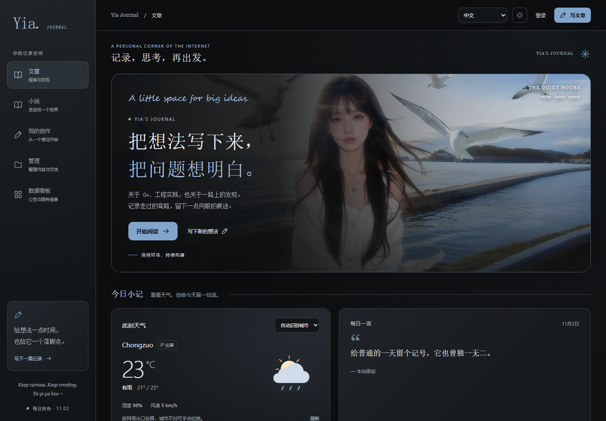
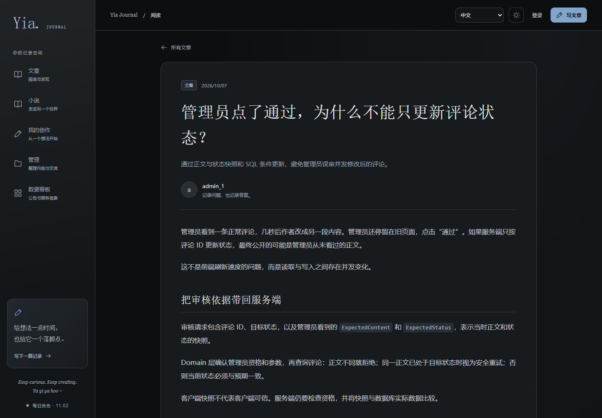
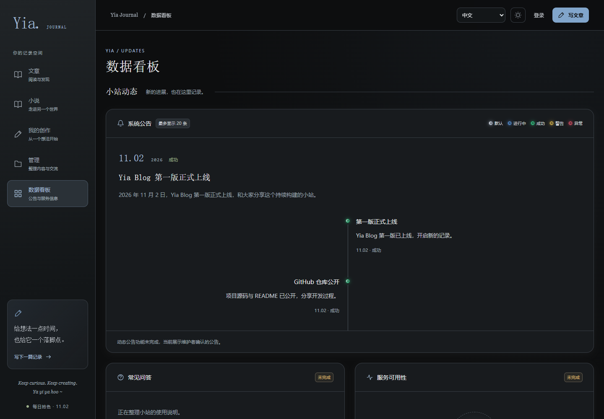
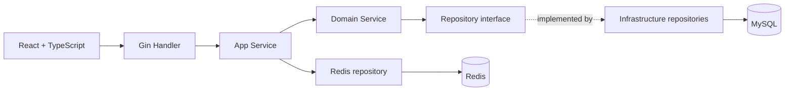

<div align="center">

# Yia Blog

**一个关于阅读、记录与分享的个人博客平台**


[在线体验](https://sryia.cn/) · [前端源码](https://github.com/Yia-Ovo/yia-blog/tree/main/blog-web) · [后端源码](https://github.com/Yia-Ovo/yia-blog/tree/main/blog-server)

**简体中文** · [English](README_EN.md)

</div>

---

Yia Blog 使用 Go 和 React 开发，提供文章阅读与创作、分类管理、评论审核和用户认证。后端采用 DDD 分层组织业务规则，前端支持多语言界面与每日主题，为个人写作和分享提供一个独立空间。

## ✨ 特性亮点

- **内容创作**：文章发布、草稿编辑、图片上传与 Markdown 导入，支持分类浏览。
- **安心写作**：浏览器草稿恢复与未保存提示，减少误操作导致的内容丢失。
- **评论互动**：评论和点赞；管理员审核，已审核评论修改后重新进入待审状态。
- **身份与权限**：用户、管理员两套 JWT 认证，支持管理员角色与令牌失效控制。
- **每日主题**：按北京时间轮换背景，提供浅色与深色页面体验。
- **多语言界面**：支持中文、英文、日文和越南文；文章正文保持作者原文。

## 📷 页面预览

以下为线上公开页面的实际截图。

**首页**



<details>
<summary>查看文章阅读与数据看板</summary>




</details>

## 🌐 在线体验

- [游客阅读](https://sryia.cn/)：无需登录即可浏览文章。
- [注册账号](https://sryia.cn/register)：注册后可使用个人写作功能。
- [数据看板](https://sryia.cn/dashboard)：查看当前公告；常见问答和服务监控仍为占位功能。

管理员功能需要授权，不提供公开管理员账号。草稿恢复仅保存在当前浏览器，界面语言切换不会翻译文章正文。

## 🧩 架构概览



Handler 处理 HTTP，App 编排用例与缓存，Domain 保证权限、资源归属和状态规则，基础设施仓储实现数据读写。Redis 用于缓存与登录状态管理；每日背景读取后端内嵌素材，不依赖数据库。

## 前端技术

- **框架**：React 19、TypeScript
- **构建工具**：Vite
- **路由**：React Router
- **内容展示**：Markdown、DOMPurify 内容净化

## 后端技术

- **语言与框架**：Go、Gin
- **数据存储**：MySQL、GORM
- **缓存与登录状态**：Redis
- **配置与日志**：Viper、Zap
- **架构**：DDD 分层，Handler → App → Domain → Repo

## 源码地址

- **前端源码**：[blog-web](https://github.com/Yia-Ovo/yia-blog/tree/main/blog-web)
- **后端源码**：[blog-server](https://github.com/Yia-Ovo/yia-blog/tree/main/blog-server)

## 项目结构

```text
blog-server/       Go 后端、测试、配置示例与数据库迁移
blog-web/          React 前端、测试与构建配置
.gitignore         Git 忽略规则
README.md          项目介绍
README_EN.md       English introduction
LICENSE            MIT 代码许可证
CONTRIBUTING.md     贡献说明
SECURITY.md         安全问题报告说明
```

源码不包含真实配置、业务数据库、个人技术文档、文章原稿或小说手稿。

## 开发运行

后端需要 Go、MySQL 和 Redis。将 `blog-server/config/config.example.yaml` 复制为本机 `config.dev.yaml`，填写数据库、Redis 和 JWT 配置；空数据库的初始化 SQL 位于 `blog-server/migrations/`。

```bash
# 终端一：启动后端
cd blog-server
go run . -c config/config.dev.yaml
```

```bash
# 终端二：启动前端（Node.js 22.12+）
cd blog-web
npm ci --ignore-scripts
npm run dev
```

访问 [http://localhost:5173](http://localhost:5173)。真实配置和密钥不要提交。

## 授权

代码采用 [MIT License](LICENSE)。第三方图片、个人作品和站点上传内容的权利独立于代码许可证。

## 🤝 交流与贡献

欢迎交流想法、反馈问题，也欢迎参与改进。

如果你发现 Bug，或有功能建议，可以提交 Issue；如果你愿意完善代码或文档，欢迎发起 Pull Request。

参与前请阅读 [贡献说明](CONTRIBUTING.md)。感谢每一份反馈与支持！安全问题请按 [SECURITY.md](SECURITY.md) 报告。
