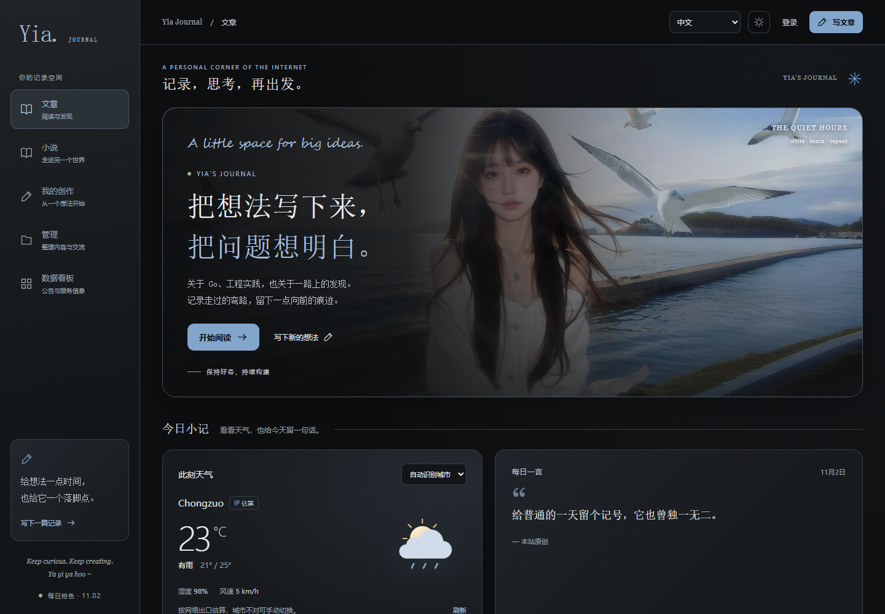
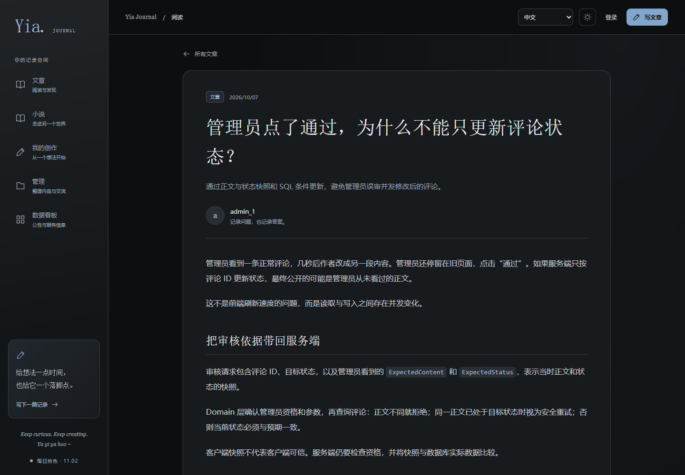
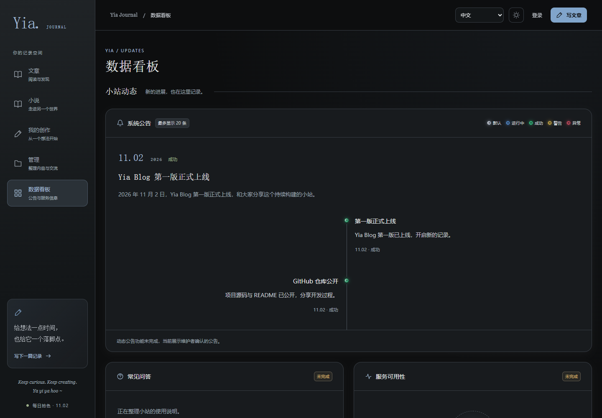
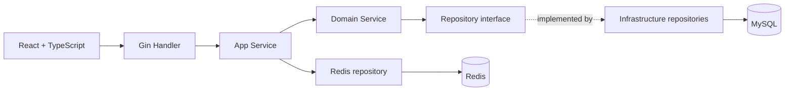

<div align="center">

# Yia Blog

**A personal blog for reading, writing, and sharing**


[Live demo](https://sryia.cn/) · [Frontend](https://github.com/Yia-Ovo/yia-blog/tree/main/blog-web) · [Backend](https://github.com/Yia-Ovo/yia-blog/tree/main/blog-server)

[简体中文](README.md) · **English**

</div>

---

Yia Blog is built with Go and React. It supports reading and writing articles, categories, comment moderation, and authentication. The backend organizes business rules using DDD layers, while the frontend offers multiple interface languages and daily themes.

## ✨ Features

- **Content creation**: Publish articles, edit drafts, upload images, import Markdown, and browse by category.
- **Draft protection**: Recover drafts in the browser and receive warnings before leaving unsaved work.
- **Comments**: Comment and like; edited comments return to moderation after previously being approved.
- **Authentication and permissions**: Separate user and administrator JWT authentication, administrator roles, and token invalidation.
- **Daily themes**: Backgrounds rotate by Beijing calendar date, with light and dark appearances.
- **Interface languages**: Chinese, English, Japanese, and Vietnamese. Article content stays in its original language.

## 📷 Preview

Actual screenshots of the public live site.

**Home**



<details>
<summary>Article reading and dashboard</summary>




</details>

## 🌐 Try it online

- [Browse articles](https://sryia.cn/) without signing in.
- [Create an account](https://sryia.cn/register) to use personal writing features.
- [Dashboard](https://sryia.cn/dashboard): view announcements. FAQ and service monitoring are still placeholders.

Administrator access requires authorization; no public administrator account is provided. Draft recovery is local to the current browser. Switching interface languages does not translate article content.

## 🧩 Architecture



Handlers process HTTP; application services coordinate use cases and caching; domain services enforce permissions, ownership, and state rules; infrastructure repositories read and write data. Redis manages caches and login state. Daily backgrounds use embedded backend assets rather than a database.

## Frontend technologies

- **Framework**: React 19, TypeScript
- **Build tool**: Vite
- **Routing**: React Router
- **Content rendering**: Markdown and DOMPurify sanitization

## Backend technologies

- **Language and framework**: Go, Gin
- **Storage**: MySQL, GORM
- **Cache and login state**: Redis
- **Configuration and logging**: Viper, Zap
- **Architecture**: DDD layers, Handler → App → Domain → Repo

## Source code

- **Frontend**: [blog-web](https://github.com/Yia-Ovo/yia-blog/tree/main/blog-web)
- **Backend**: [blog-server](https://github.com/Yia-Ovo/yia-blog/tree/main/blog-server)

## Repository layout

```text
blog-server/       Backend, tests, configuration example, and migrations
blog-web/          Frontend, tests, and build configuration
.gitignore         Git ignore rules
README.md          Chinese introduction
README_EN.md       English introduction
LICENSE            MIT license
CONTRIBUTING.md     Contribution guidelines
SECURITY.md         Security reporting policy
```

The repository excludes real configuration, business databases, private technical notes, article manuscripts, and novel manuscripts.

## Local development

The backend requires Go, MySQL, and Redis. Copy `blog-server/config/config.example.yaml` to `config.dev.yaml` in the same directory and fill in the database, Redis, and JWT settings. The initial schema for an empty database is in `blog-server/migrations/`.

```bash
# Terminal 1: start the backend
cd blog-server
go run . -c config/config.dev.yaml
```

```bash
# Terminal 2: start the frontend (Node.js 22.12+)
cd blog-web
npm ci --ignore-scripts
npm run dev
```

Open [http://localhost:5173](http://localhost:5173). Do not commit real configuration or secrets.

## License

Code is licensed under the [MIT License](LICENSE). Third-party images, personal works, and uploaded site content have separate rights.

## 🤝 Community and contributions

Ideas, feedback, and contributions are welcome.

If you find a bug or have a feature suggestion, open an Issue. To improve code or documentation, submit a Pull Request.

Please read the [contribution guidelines](CONTRIBUTING.md) before contributing. Thank you for your feedback and support! Report security issues according to [SECURITY.md](SECURITY.md).
